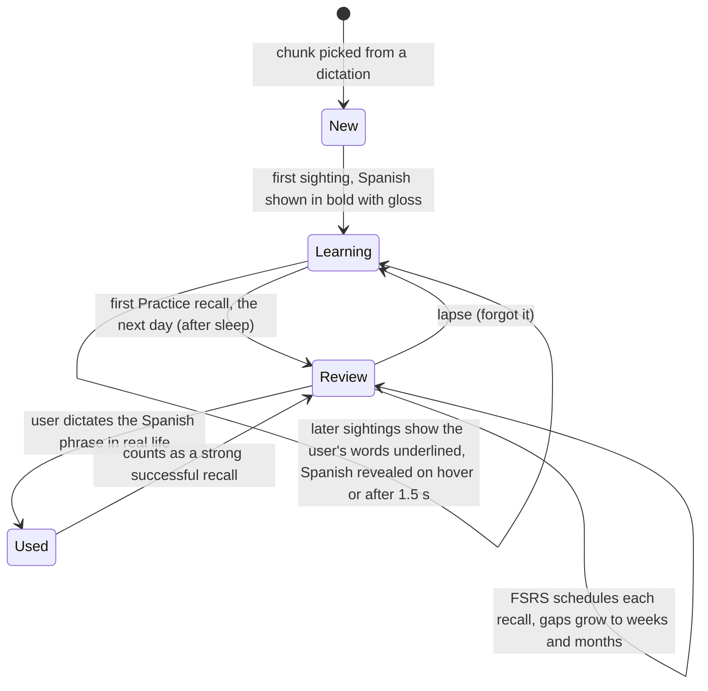

# Spanish Coach: what the learning research says, and what to build next

Date: 2026-10-28. Synthesis of five research reports (memory science, second-language acquisition, speaking and pronunciation, habits and motivation, product prior art). The full reports, with every citation, sit next to this file:

- `memory-science.md`: spacing, retrieval practice, sleep, a full FSRS-6 scheduler spec.
- `second-language-acquisition.md`: encounters, glossing, chunks, mixed-language text, feedback types.
- `speaking-and-pronunciation.md`: ASR feedback, listening training, Spain-Spanish sound targets, TTS.
- `habits-and-motivation.md`: habit formation, interruptions, streaks, the "brain hacks" that do and don't hold up.
- `product-prior-art.md`: Toucan, WaitChatter, VocabEncounter, Duolingo, Anki/FSRS, LingQ and others.

Evidence labels below: MA is a meta-analysis, Exp is a controlled experiment, Field is a deployment study.

## The short version

The capture-and-translate card puts the right content (the user's own sentences) in front of the user at a good moment (just after paste). It does not yet make the user remember anything. Three findings carry most of the weight:

1. Mixed-language text on its own has no rigorous evidence behind it. No controlled study of diglot weave or Toucan-style word swapping exists (SLA F27). Incidental learning from reading yields 9 to 18% of target words immediately and 6 to 17% after a delay (Webb, Uchihara & Yanagisawa 2023, MA, 24 studies, https://doi.org/10.1017/S0261444822000507). A single word needs about 10 encounters in context (Webb 2007, https://doi.org/10.1093/applin/aml048) and a multiword phrase needs about 15.
2. Recalling beats re-reading, by a wide margin. Testing beats restudying (Rowland 2014, MA). Once a learner can recall an item, dropping it from tests is what causes forgetting (Karpicke & Roediger 2008). Generating an answer beats reading it (MA, 86 studies). Learners consistently judge these harder methods as worse even when they work better.
3. Spacing should be wider than the current schedule. For one-year retention the best gap between reviews is roughly 18 to 36 days (Cepeda et al. 2008, more than 1,350 participants, https://doi.org/10.1111/j.1467-9280.2008.02209.x). The current ladder stops at 16 days, and a new phrase is due the moment it is created.

So the main direction is to turn each phrase's appearances on the card from passive exposure into a short recall attempt, and to schedule those attempts properly.

The feature already gets several things right, and the research supports keeping them:

- It never alters the pasted text. ALOE, a Firefox add-on that swapped English words for French ones inside pages, lost users because it slowed their work (Trusty & Truong, CHI 2011).
- The card appears just after paste. In MIT's WaitChatter study, a vocabulary card shown 1.5 s after the user sent a chat message got a 49% response rate, against 44.5% at random times (Cai et al., CHI 2015).
- Glosses are in the user's own language. L1 glosses beat Spanish-language glosses, and the gap is largest for beginners (SLA F10, F11).
- Practice asks the user to say the Spanish from memory. Producing the L2 word from an L1 cue beats repeating after a native speaker (memory F10).
- The example sentence is the user's own. The self-reference effect is about d = 0.65 over plain meaning-based study (Symons & Johnson 1997, MA, 129 studies).

## How a phrase should move through the feature

Today a phrase is shown in bold Spanish every time it comes up, and only the Practice screen tests it. The proposal is a lifecycle where each stage asks a little more of the user:

## Ideas, ranked

Tier 1 has the strongest evidence and fits the current code with modest changes. Tier 2 is well supported but adds new UI or new data. Tier 3 is experimental or larger.

### Tier 1: make the card and Practice do retrieval

**1. Recall on the card for returning phrases.** When a stored phrase comes up again, show the user's own words underlined in place of the Spanish, and reveal the Spanish on hover or after about 1.5 s. Keep the bold-Spanish view for a phrase's first sighting only. Guessing before seeing the answer helps even when the guess is wrong (memory F16, Exp), and a short pause beats a long guessing period (SLA F13). Hovering to reveal the Spanish can count as a weak "didn't recall" signal. This conflicts with the current card, which always shows the answer.

**2. One new chunk per card; the other slots are reviews.** Split `chunkCount` into one slot for a new phrase and the rest for phrases that are due. This caps how fast the phrase list grows and gives each phrase the repeated encounters it needs (SLA F1 to F3). Today every eligible dictation can add up to five new phrases.

**3. Make reinforcement follow the schedule.** `SpanishPhraseStore.reinforcementCandidates` picks low-mastery phrases by recency and ignores `nextReviewAt`. Pick due phrases first. Stop telling the LLM to avoid mastered phrases. A mastered phrase that comes up after a long gap is a free, well-timed review (memory F9). VocabEncounter (Arakawa et al., CHI 2022) also shows that a model can fit a target word into new text, so the LLM can be asked "which due phrase fits this sentence?" instead of requiring the exact English source text.

**4. Replace the Leitner ladder with FSRS.** The memory report has a complete FSRS-6 spec: formulas, default parameters, grade mapping (wrong is Again, close is Hard, correct is Good, a fast correct answer is Easy), and a migration from the current `mastery` field. On an open benchmark FSRS beats Duolingo's half-life regression (log loss 0.346 against 0.469). It needs no training data to start. Keep a derived 0 to 5 mastery value for the dots in My Spanish and for the chunk-count ramp. Two cheaper steps can ship first if FSRS is too large for one change: set the first review to the next day instead of `now`, and extend the interval ladder past 16 days to 32, 64 and 128.

**5. First review after a night's sleep.** Sleeping between a first study session and a relearning session halved the relearning effort and improved retention at six months (Mazza et al. 2016, Exp, 40 participants). Set a new phrase's first review to the user's first dictation window the next day. The effect is real but moderate, about g = 0.28 after correcting for publication bias (habits F26).

**6. Hint, retry, then reveal in Practice.** Making learners correct themselves beats simply showing them the correct form (Lyster & Ranta; Li 2010, MA; SLA F20, speaking F14). On a "close" or "wrong" answer, give one line of hint ("vosotros ending", "the rr in perro is rolled"), let the user try once more, then show the corrected version. The grader prompt currently returns `corrected` straight away.

**7. Give "Just show me" less credit.** Self-grading is unreliable because learners can't predict their own recall (SLA F7). A self-graded "I knew it" should count at most as Good, never Easy. Nudge toward a spoken attempt first.

**8. Count real-world use as the best possible review.** When the user dictates a stored Spanish phrase in an ordinary dictation, log it as a successful production recall. It costs the user nothing and it is the strongest evidence the app can collect (memory idea 6). The pipeline hook in `TranscriptionPipeline.swift` already passes every pasted dictation to the coach.

### Tier 2: better chunks, better timing, listening and audio

**9. Pick chunks the user actually says often.** Build a local, on-device count of the English and Russian phrases the user dictates most, using the saved transcription history. Pass the top recurring phrases to the chunk prompt. "Swap in the most frequent content words" was a rule that a learner-model optimiser could not beat (Labutov & Lipson 2014, ACL). Personal frequency adds the self-reference effect on top. A small core of Spanish covers most speech (SLA F24), so personal frequency and Spanish frequency together should decide.

**10. Swap only where word order lines up.** Real bilinguals switch languages only at points where both languages' word order agrees (SLA F28). Add prompt rules: swap whole noun phrases, fixed expressions (tengo que, me apetece, hace falta) and discourse markers. Never drop a conjugated Spanish verb into a slot where the surrounding English or Russian word order clashes with it. A badly placed chunk teaches wrong usage.

**11. Flag false friends, limit cognates.** English and Spanish share an estimated 10 to 15 thousand cognates. Cognates are easier to learn but add little, so allow at most one per card. Mark false friends in the gloss (embarazada, constipado, éxito; for Russian speakers the report could not confirm a list, so ask the LLM to flag them). Add a "why?" line per chunk for Spain-specific choices such as ordenador against computadora, or vosotros.

**12. Hear it, after trying.** macOS has a Spain-Spanish TTS voice (Mónica) through `AVSpeechSynthesizer`. In Practice, play the model pronunciation after the user's attempt, not before (speaking F11). Computer voices are understood about as well as human ones (speaking F18). No TTS code exists in the app today.

**13. Listening drill for Spain-Spanish sound pairs.** High-variability phonetic training, which plays the same contrast in many voices and asks which sound the user heard, has g = 0.67 against controls (Uchihara, Karas & Thomson 2025, MA, 79 studies). Pairs: pero/perro, caro/carro, casa/caza, coser/cocer, término/termino/terminó, papa/papá. It never grades the user's speech, so ASR errors don't matter. The limit is voice variety: macOS installs one compact es-ES voice by default, and others must be downloaded.

**14. Don't trust ASR as a pronunciation judge.** Whisper-large-v3 had about 12% word error rate on English and Russian speakers learning Spain Spanish, and it sometimes silently corrected the learner's grammar in the transcript (Sarymsakova & Martín-Rodilla 2025). Judge pronunciation only on a short list of known confusions for the user's native language (rr against r, z/ce/ci against s, unstressed vowels), and keep the review schedule based on recall only. Rhythm and stress matter more for being understood than single sounds (Derwing, Munro & Wiebe 1998), so mark the stressed syllable on the card.

**15. Respect attention.** Holding interruptions until a natural break reduces frustration (Iqbal & Bailey). Concretely:
- Log the time from paste to card. If the LLM takes more than 2 to 3 s, show the card at the next app switch instead.
- Pause the 8 s close timer while the user is still typing; WaitChatter users disliked cards that vanished too early.
- Keep a "today's Spanish" list in the menu bar so a missed card isn't lost.
- Extend the call-app block list beyond Zoom, Teams and FaceTime to Google Meet in a browser, Webex, Slack huddles, Discord and active screen sharing.
- Add a daily card cap and learn per-app engagement. WaitChatter engagement was lowest in work conversations.

**16. Show coverage and real retention, not points.** Expected tangible rewards undermine intrinsic motivation, while informative feedback raises it (Deci, Koestner & Ryan 1999, MA). Gamification effects in education are small and fragile. Good progress measures: "you can say 34 of your 100 most-dictated phrases", and the user's actual recall rate. Showing real numbers also counters the "this feels harder" reaction to recall cards. If a streak exists, make it repairable, and auto-freeze days with no dictation.

**17. Vary the example sentence after the first reviews.** Varied contexts help a meaning generalise, but beginners learn faster from a single context at first (memory F21). Keep the original sentence for the first one or two reviews, then pull new sentences from the user's own past dictations. Keep near-synonyms such as móvil, ordenador and portátil out of the same session (memory F20).

### Tier 3: experimental and larger

**18. Spanish-attempt feedback.** When the user dictates in Spanish, offer one focused correction as an opt-in card, using the same hint-first approach as idea 6.

**19. Weekly speaking task on the user's own topics.** A 4/3/2 retell: tell the same short story three times in 90, 60 and 45 seconds. Fluency gains need the content to stay the same (speaking F15). ASR word timestamps give words per minute and pause counts. A short voice roleplay seeded from the week's dictations is the other option, with privacy implications.

**20. Shadowing session.** TTS reads three to five of the user's own sentences, translated into Spanish, at 0.8x then 1.0x speed. Shadowing mainly helps basic sound recognition, mostly for weaker learners (speaking F10). Good for a beginner; low cost once TTS exists.

**21. Keyword mnemonics for stubborn phrases.** After three or more lapses, the LLM proposes an English or Russian sound-alike image. Keyword mnemonics help at first but fade faster than retrieval practice (memory F26), so the phrase stays in normal review.

**22. Confidence tap.** Before revealing the answer, one tap for "sure" or "guessing". Confident errors are the easiest to fix once corrected (the hypercorrection effect, memory F17), so show those corrections prominently.

**23. One if-then plan at setup.** "When I first dictate after 9:00, I do three reviews." If-then plans have a reliable but small effect, and mostly help people remember to act. Anchoring to a routine and to a clock time worked equally well (habits F2, F4). Pair with a fresh-start offer after a week of inactivity.

**24. Anki or CSV export.** Low cost, and gives serious learners a way out.

## Popular ideas the evidence does not support

- "You'll learn effortlessly just by seeing words." Exposure is not recall, and incidental gains are small.
- "Seen 100 times means learned." Toucan counts words as learned by views; its users complain that learned words keep reappearing.
- "Pictures beat translations." They don't for foreign words, though learners believe they do (memory F24). Skip stock images.
- "Expanding intervals are essential." Total spacing and a delayed first review matter; the exact curve shape barely does.
- "A matching transcript means good pronunciation." It only shows the words were recognised.
- "More AI help or more personalisation means more learning." Studies of Storyfier and similar tools found higher motivation, not higher learning.
- "Habits form in 21 days." The median in Lally et al. (2010) was 66 days, with a range of 18 to 254, and only for the 39 of 96 participants whose data fit the model.
- The Mozart effect, exercise-for-BDNF as a learning hack, and the Zeigarnik effect. None holds up. The Ovsiankina effect, the urge to finish an interrupted task, does; a "2 of 5 left" menu-bar count uses it.

## Code issues found during the review

These came up while checking ideas against the code. None is urgent.

- `SpanishPhraseStore.masteredCount` counts mastery 3 and above, while `masteredPhrases` (the avoid list) uses mastery 5. Both are called "mastered".
- `reinforcementCandidates` ignores `nextReviewAt`, so card reinforcement doesn't respect spacing.
- A new phrase has `nextReviewAt = now`, so its first Practice review can come minutes after the first sighting.
- Card sightings update `timesSeen` only. They never affect mastery or scheduling, which is right for first sightings but wastes recall attempts once idea 1 exists.

## Suggested first slice

Ideas 1, 2, 3 and 5, plus the cheap half of idea 4 (first review next day, ladder extended past 16 days). Together they turn the card into a recall tool without new screens, new data sources or a scheduler rewrite. FSRS (idea 4 in full), hint-and-retry (6) and TTS (12) make a natural second slice.
